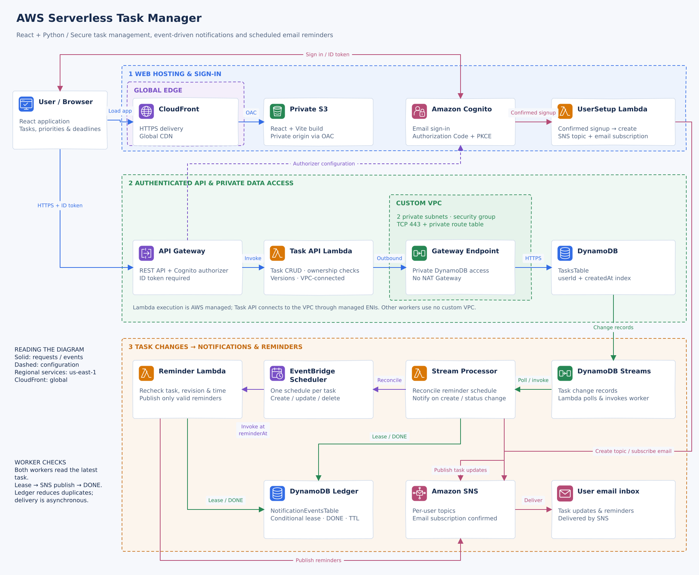

# AWS Serverless Task Manager

A serverless task management application with secure authentication, deadline tracking, and automated email reminders. Built with React, Python, and AWS.

[Live Demo](https://d2bbysp6jac78g.cloudfront.net/) · [Architecture](#architecture)

<table>
<tr>
<td align="center"> CloudFront</td>
<td align="center"> S3</td>
<td align="center"> Cognito</td>
<td align="center"> API Gateway</td>
<td align="center"> Lambda</td>
</tr>
<tr>
<td align="center"> VPC Endpoint</td>
<td align="center"> DynamoDB</td>
<td align="center"> DynamoDB Streams</td>
<td align="center"> EventBridge Scheduler</td>
<td align="center"> SNS</td>
</tr>
</table>

## Application Preview

[Open the live application](https://d2bbysp6jac78g.cloudfront.net/) to explore the task dashboard. Registration and email verification are required to use the deployed application. Confirm the separate SNS email subscription to receive notifications.

<!-- Add a dashboard screenshot using English sample tasks at assets/preview/dashboard.png,
then replace this comment with:

Capture the actual application without personal email addresses or tokens.
-->

## Key Features

- Secure email registration and sign-in.
- Create, edit, complete, reopen, and delete tasks.
- Search, filter, and sort tasks.
- Track deadlines and task progress.
- Receive task updates and scheduled email reminders.

## Architecture

[View full-size diagram](assets/architecture/task-manager-architecture.svg) · [Editable draw.io file](assets/architecture/task-manager-architecture.drawio)

- **Frontend delivery:** CloudFront serves the React build from a private S3 bucket using Origin Access Control (OAC).
- **Authentication and API:** Cognito handles Authorization Code + PKCE sign-in. API Gateway validates the ID token before invoking Task API Lambda, which checks task ownership.
- **Private data access:** Task API connects to a VPC with two private subnets, a security group, and a private route table. A DynamoDB Gateway Endpoint provides database access without a NAT Gateway.
- **Notifications and reminders:** DynamoDB Streams invokes Stream Processor to reconcile schedules and publish task updates. EventBridge Scheduler invokes Reminder at the scheduled time; both workers use a DynamoDB notification ledger before publishing to SNS. UserSetup provisions per-user topics after confirmed signup.

## Engineering Highlights

| Area | Implementation |
|---|---|
| Authentication & authorization | Cognito PKCE, a REST API authorizer, and task ownership checks protect user data. |
| Private connectivity | VPC-connected Task API uses private subnets and a DynamoDB Gateway Endpoint for database access. |
| Event-driven processing | DynamoDB Streams separates task writes from notification processing and schedule reconciliation. |
| Reminder consistency | Deterministic schedule names prevent multiple schedules per task; current-state and revision checks reject stale reminders. |
| Duplicate reduction | Conditional DynamoDB leases track processing; workers mark notifications DONE only after SNS publish succeeds. |
| Cost awareness | Serverless services and DynamoDB connectivity without a NAT Gateway keep the demo infrastructure small. |
